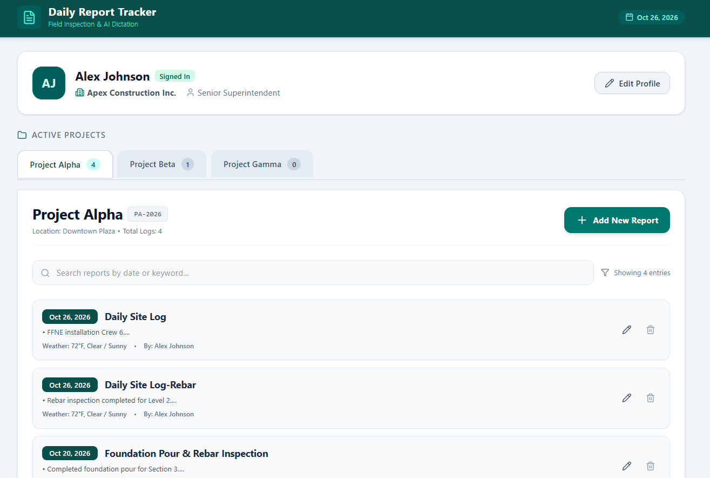
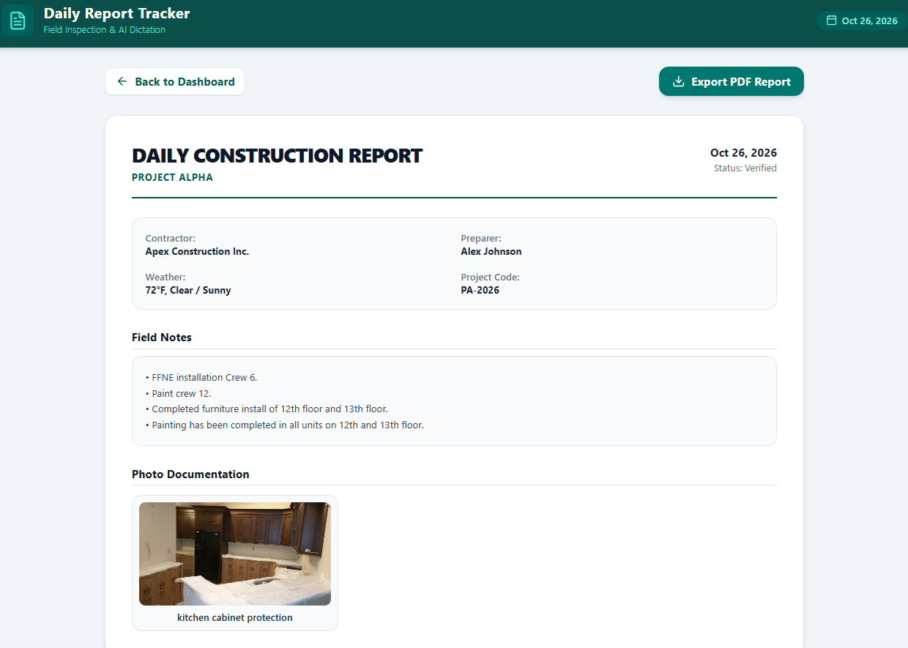

# 🏗️ Construction Daily Report Tracker (PWA)

A field-ready, offline-first Progressive Web App (PWA) for construction superintendents and project managers. Log daily site activity, dictate field notes hands-free with voice recognition, document job site photos with captions, and export clean PDF daily reports.



## 🌟 Key Features

- **📱 Installable PWA** – Installs on iOS, Android, macOS, and Windows with its own app icon and home-screen name ("Daily Reports"). Critical assets and icons are cached locally, so the app opens and runs in job site dead zones with no cell service.
- **🔐 Accounts & Login** – Email and password sign-up with email confirmation (Supabase Auth), plus **Forgot password** (reset link by email, then a Set New Password screen). Users stay signed in on their device, and the sign-in check works offline. Row Level Security ensures each user can only see and change their own data.
- **☁️ Offline-First Cloud Sync** – Every change is saved on the device first, marked as unsent, and synced to Supabase automatically: when the app opens, a few seconds after each change, when the connection returns after a dead zone, and every 5 minutes (plus a manual **Sync Now** button). Changes from other devices are downloaded, the newest version wins, and unsent local edits are never overwritten. Deletions sync too.
- **🚪 Safe Sign-Out** – Signing out sends any unsent changes first, warns if something couldn't be sent, then clears the device so the next person can't see the previous user's reports. Data returns automatically on the next sign-in.
- **💾 Offline Storage with IndexedDB** – Profiles, reports, and photos are stored on the device in IndexedDB (via Dexie.js), so the app works fully without signal. The app only confirms a save after the data is actually stored.
- **🖼️ Cloud Photo Storage** – Photos are uploaded once to a private Supabase Storage bucket (one folder per user, protected by a security policy) and downloaded only on devices that don't have them yet. Reports in the cloud store just each photo's ID, caption, and location. Removing a photo, deleting a report, or deleting a project also deletes the photo files from Storage.
- **🗂️ Project Management** – Add, edit, and delete projects (name, code, location). The newest project appears as the first tab and opens by default. Deleting a project also deletes its reports, after a confirmation warning.
- **📅 Smart Report Defaults** – New reports open with today's date (with a calendar picker to change it) and the current local weather, fetched automatically from your location. Both can be edited manually.
- **🎙️ AI Voice Dictation** – Tap **Record**, speak, and tap **Stop**. The recording is transcribed by OpenAI (`gpt-4o-mini-transcribe`) through a Supabase Edge Function, with a built-in list of construction terms (FF&E, RFI, MEP, punch list, and more) to improve spelling of site language. The text is added as a bullet point. Works on iPhone (Safari) as well as Chrome and Edge. The OpenAI key stays on the server and is never exposed to the app, and only signed-in users can use the function.
- **📡 Offline Voice Notes** – With no signal (or too weak a signal to reach the server), recordings are saved on the device and the form shows how many are waiting. Once the phone is back online, waiting notes are transcribed automatically, added to their report in the order they were recorded, and synced to the cloud.
- **📸 Photo Documentation & Labeling** – Add photos from the camera or device storage, store them offline, and attach trade or location captions. Photos are automatically resized (max 1600px) and compressed to JPEG before saving, typically about 15–20× smaller (e.g., 2.7 MB → 159 KB). iPhone HEIC photos are converted automatically, so they also work in Windows browsers. In the report, photos are shown in full without cropping.
- **📄 PDF Export** – Uses the browser's built-in print engine with custom print CSS to produce formatted daily report PDFs, with no external server required. After saving, the report opens straight to the preview, ready to export.
- **👓 Readable on Phones** – Larger, darker text on phones for report previews, field notes, and form fields, tested with users of different ages. Form text is 16px, which also stops iPhones from auto-zooming when a field is tapped.
- **⚡ Responsive, High-Contrast UI** – Built with React 19, Vite, and Tailwind CSS v4, with high contrast for outdoor visibility.

## 🛠️ Tech Stack

| Area | Technology |
| --- | --- |
| Frontend | React 19 + Vite |
| Styling | Tailwind CSS v4 |
| Icons | Lucide React |
| Offline Storage | IndexedDB via Dexie.js |
| Backend & Auth | Supabase (Postgres, Auth, Row Level Security, Storage) via `@supabase/supabase-js` |
| Hosting | Netlify (auto-deploys from GitHub `main`) |
| PWA / Offline | vite-plugin-pwa (service worker) |
| Weather | Open-Meteo API (free, no API key) + browser Geolocation |
| Photo Processing | Browser Canvas API (resize & compress) + heic2any (HEIC → JPEG) |
| Speech-to-Text | Browser `MediaRecorder` + OpenAI transcription API via Supabase Edge Function (`transcribe`) |
| PDF Export | Browser print engine (`window.print()` + `@media print`) |

## 📁 Project Structure

```
daily-report-tracker/
├── docs/                  # README screenshots
├── public/
│   ├── favicon.svg            # K logo (browser tab & app header)
│   ├── apple-touch-icon.png   # iPhone/iPad home-screen icon (180×180)
│   ├── pwa-192x192.png        # Android home-screen icon
│   ├── pwa-512x512.png        # Android splash screen / large icon
│   ├── maskable-512x512.png   # Android icon for circle/rounded crops
│   └── icons.svg
├── src/
│   ├── App.jsx            # Main component, views & state management
│   ├── AuthScreen.jsx     # Sign-in, create-account, forgot & set-new-password screens
│   ├── db.js              # IndexedDB database setup (Dexie.js)
│   ├── supabase.js        # Supabase connection
│   ├── sync.js            # Offline-first cloud sync (send & receive)
│   ├── voiceQueue.js      # Offline voice notes: transcribe when back online
│   ├── main.jsx           # Application entry point
│   └── index.css          # Tailwind directives & @media print styles
├── .env.local             # Supabase settings (not committed to Git)
├── vite.config.js         # Vite config with Tailwind CSS v4 & PWA plugin
├── package.json
└── README.md
```

## 🚀 Getting Started

### Prerequisites

- Node.js v18 or later
- Google Chrome or Microsoft Edge (recommended for voice dictation)

### Installation

```bash
git clone https://github.com/Kiki-K82/daily-report-tracker.git
cd daily-report-tracker
npm install
```

### Supabase Settings

Create a file named `.env.local` in the project folder (next to `package.json`) with your Supabase project's URL and **publishable** key:

```
VITE_SUPABASE_URL=https://your-project-id.supabase.co
VITE_SUPABASE_PUBLISHABLE_KEY=sb_publishable_your_key_here
```

- Use the base URL only (no `/rest/v1/` at the end).
- Never use the **secret** key in this app.
- `.env.local` is excluded from Git. For the live site, add the same two variables in **Netlify → Project configuration → Environment variables** (not marked as secret).

### Voice Dictation (Supabase Edge Function)

The `transcribe` Edge Function is created in the Supabase dashboard (**Edge Functions → Deploy a new function → Via Editor**). Name it `transcribe` *before* the first save, since the first name becomes its web address. Keep **Verify JWT** on so only signed-in users can call it.

Store the OpenAI API key under **Edge Functions → Secrets** as `OPENAI_API_KEY`. Never put this key in the app, `.env.local`, or Netlify. Use a low spending limit and keep auto-recharge off while testing.

To improve recognition of site terms, edit the `CONSTRUCTION_TERMS` list in the function and redeploy.

Then start the app:

```bash
npm run dev
```

Open http://localhost:5173/ in your browser.

> ⚠️ **Note:** Test in a regular Chrome or Edge window, not an embedded IDE preview (such as VS Code's built-in browser), so microphone, location, and storage permissions work correctly.

### Inspecting Stored Data

Press **F12 → Application → IndexedDB → DailyReportTrackerDB** to see the `reports`, `profile`, `projects`, `deletions`, and `meta` tables. Records with `dirty: 1` haven't been sent to the cloud yet. Use **Refresh database** to update the view (never **Delete database**).

Cloud data is in the Supabase dashboard under **Table Editor** (`projects`, `reports`, `profiles`). Photo files are under **Storage → photos**, organized as `user-id/report-id/photo-id.jpg`.

**Testing sync on one laptop:** An InPrivate/Incognito window has its own storage, so it acts like a second device. Sign in with the same account in both windows.

## 📱 Testing on Your Phone

**Phone view in the browser:** Press **F12**, then **Ctrl + Shift + M**, and choose a phone from the **Dimensions** dropdown.

**On a real phone:** With the phone and laptop on the same Wi-Fi, start the server with:

```bash
npm run dev -- --host
```

Then open the **Network** address shown in the terminal (e.g., `http://192.168.1.25:5173/`) in the phone's browser.

> ⚠️ **Note:** The microphone and automatic weather usually won't work this way, because phones only allow them on secure (https) sites. Layout and text sizes are accurate.

## 📲 Testing Offline Mode

Service workers only run in a production build:

```bash
npm run build
npm run preview
```

1. Open the preview URL (usually http://localhost:4173/).
2. Press **F12** to open Developer Tools.
3. In the **Network** tab, set throttling to **Offline** (or check **Offline** under **Application → Service Workers**), then refresh the page.

## 📝 Usage Guide

1. **Sign In** – Create an account with your email and a password, confirm your email, then sign in. Forgot it? Tap **Forgot password?** to get a reset link by email.
2. **Profile Setup** – Enter your company name and superintendent details.
3. **Projects** – Click **Add Project** to create a project. Use the **pencil** next to the project code to edit or delete it.
4. **Create a Daily Report** – Select a project and click **Add New Report**. Today's date and local weather fill in automatically (allow location access when prompted); change either if needed.
5. **Voice Dictation** – Tap **Record**, speak your field observations, then tap **Stop**. The text is added as a bullet point. No signal? The note is saved and added automatically once you're back online. Just save the report as usual.
6. **Photos** – Click **+ Add Site Photo**, then add a caption (e.g., "Foundation Pour – Grid C4").
7. **Save & Export** – Click **Save Report**. The finished report opens immediately; click **Export PDF Report** to save or print it.
8. **Sync** – Happens automatically. Use **Sync Now** to sync immediately. Sign in on another device to see the same reports.
9. **Sign Out** – Sends unsent changes, then clears the device. Your data stays in the cloud.



## ⚠️ Known Limitations

- **Older photos:** Reports synced before photo storage was added keep their images inside the report's cloud record. They move to Storage automatically the next time the report is edited and saved.
- **Sample data:** New accounts start with sample projects (Alpha, Beta, Gamma). They may briefly appear before a user's own data downloads after sign-in.
- **Email sending:** Supabase's built-in email service is limited to a few emails per hour, which is fine for testing.
- **Voice dictation:** Accuracy depends on how clearly terms are spoken (e.g., "FF&E" said quickly may come out as "epiphany"). Each recording currently becomes one bullet; an AI cleanup step to split and tidy notes is planned. Background conversations on a noisy site may be picked up. Holding the phone close or using earbuds with a mic helps.
- **Offline voice notes:** Notes recorded in a report that is never saved (form cancelled) are discarded after 7 days.
- **Weather:** Automatic weather requires location permission and an internet connection. Offline, the field stays blank for manual entry.

## 🗺️ Roadmap

- [x] Move storage to IndexedDB (Dexie.js) for larger, more reliable offline storage
- [x] Default to today's date with a calendar picker, and auto-fill local weather
- [x] Open the saved report directly after saving
- [x] Add, edit, and delete projects (newest project first)
- [x] Larger, higher-contrast text for phone readability
- [x] Compress photos before saving to reduce storage use (with HEIC support)
- [x] Data export/import backup (temporary, for testing; removed once cloud sync was added)
- [x] Accounts and login with Supabase (email & password, Row Level Security)
- [x] Offline-first cloud sync across devices (automatic, with safe sign-out)
- [x] Move photos to Supabase Storage (with cleanup of deleted photos)
- [x] "Forgot password" flow
- [x] Remove the temporary backup buttons
- [x] AI transcription with construction terminology (OpenAI via Supabase Edge Function)
- [x] Offline recording that transcribes automatically once back online
- [ ] AI cleanup of dictated notes (split into clean bullets, fix terms, drop off-topic chatter)
- [x] Hosted deployment on Netlify (accessible from any network)
- [x] Custom app icons and PWA manifest (installable with its own icon)
