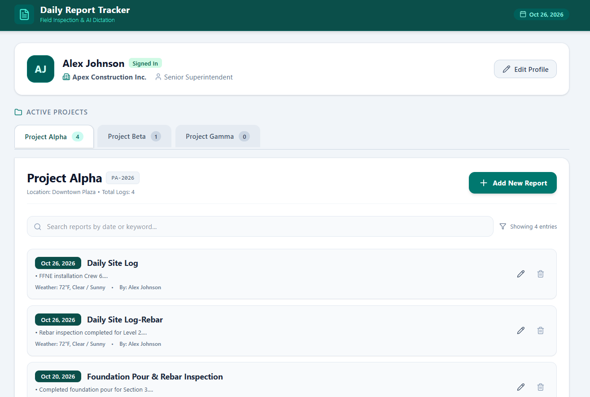
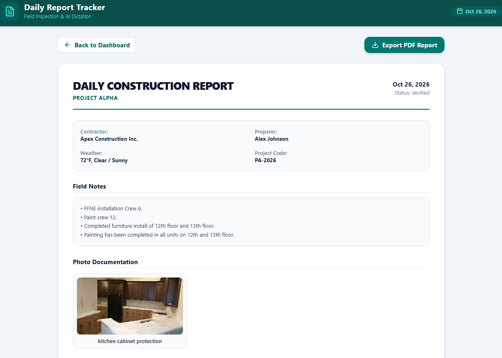

# 🏗️ Construction Daily Report Tracker (PWA)

A field-ready, offline-first Progressive Web App (PWA) for construction superintendents and project managers. Log daily site activity, dictate field notes hands-free with voice recognition, document job site photos with captions, and export clean PDF daily reports.

   

## 🌟 Key Features

- **📱 Installable PWA** – Installs on iOS, Android, macOS, and Windows. Critical assets are cached locally, so the app opens and runs in job site dead zones with no cell service.
- **💾 Local-First Persistence** – Project profiles, superintendent details, and field reports are saved in the browser and persist across sessions.
- **🎙️ Hands-Free Voice Dictation** – Uses the Web Speech API to transcribe spoken notes directly into the daily log while walking the site.
- **📸 Photo Documentation & Labeling** – Add photos from the camera or device storage, store them offline, and attach trade or location captions.
- **📄 PDF Export** – Uses the browser's built-in print engine with custom print CSS to produce formatted daily report PDFs, with no external server required.
- **⚡ Responsive, High-Contrast UI** – Built with React 18, Vite, and Tailwind CSS v4, with high contrast for outdoor visibility.

## 🛠️ Tech Stack

| Area | Technology |
| --- | --- |
| Frontend | React 18 + Vite |
| Styling | Tailwind CSS v4 |
| Icons | Lucide React |
| PWA / Offline | vite-plugin-pwa (service worker) |
| Speech-to-Text | Web Speech API (`SpeechRecognition`) |
| PDF Export | Browser print engine (`window.print()` + `@media print`) |

## 📁 Project Structure

```
daily-report-tracker/
├── public/
│   ├── favicon.ico
│   ├── robots.txt
│   └── apple-touch-icon.png
├── src/
│   ├── App.jsx            # Main component & state management
│   ├── main.jsx           # Application entry point
│   └── index.css          # Tailwind directives & @media print styles
├── vite.config.js         # Vite config with Tailwind CSS v4 & PWA plugin
├── package.json
└── README.md
```

## 🚀 Getting Started

### Prerequisites

- Node.js v18 or later
- Google Chrome or Microsoft Edge (recommended for voice dictation)

### Installation

```bash
   git clone https://github.com/Kiki-K82/daily-report-tracker.git
   cd daily-report-tracker
   npm install
   npm run dev
```

Then open http://localhost:5173/ in your browser.

> ⚠️ **Note:** Test in a regular Chrome or Edge window, not an embedded IDE preview (such as VS Code's built-in browser), so microphone and storage permissions work correctly.

## 📲 Testing Offline Mode

Service workers only run in a production build:

```bash
npm run build
npm run preview
```

1. Open the preview URL (usually http://localhost:4173/).
2. Press **F12** to open Developer Tools.
3. In the **Network** tab, set throttling to **Offline** (or check **Offline** under **Application → Service Workers**), then refresh the page.

## 📝 Usage Guide

1. **Profile Setup** – Enter your company name and superintendent details.
2. **Create a Daily Report** – Select or add a project, enter weather conditions, and start logging.
3. **Voice Dictation** – Tap **Record** and speak your field observations. Each phrase is added as a bullet point.
4. **Photos** – Click **+ Add Site Photo**, then add a caption (e.g., "Foundation Pour – Grid C4").
5. **PDF Export** – Open a saved report and click **Export PDF Report** to save or print it.

   

## ⚠️ Known Limitations

- **Storage:** Data is currently stored in `localStorage` (about 5 MB per site), so many photos can fill it up. Data lives only in the browser and device where it was entered.
- **Voice dictation:** In Chrome and Edge, speech recognition usually requires an internet connection. It is not supported in Firefox, and support in Safari is limited.

## 🗺️ Roadmap

- [ ] Move storage to IndexedDB (Dexie.js) for larger, more reliable offline storage
- [ ] Data export/import backup
- [ ] Cloud sync with Supabase (accounts, multi-device access, photo storage)
- [ ] Phone-optimized layout and hosted deployment
